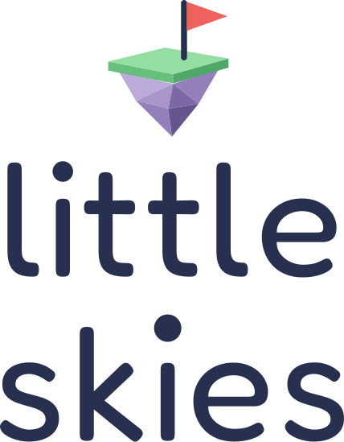
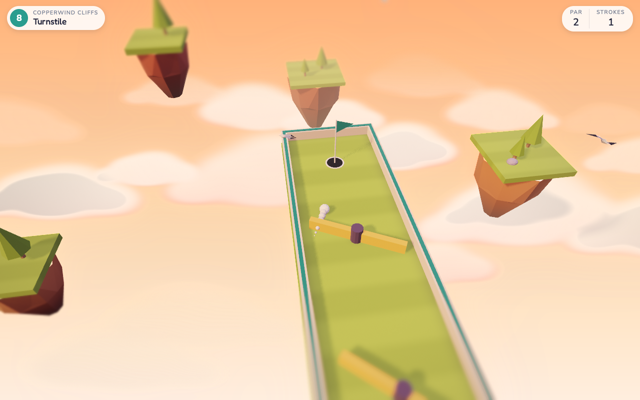
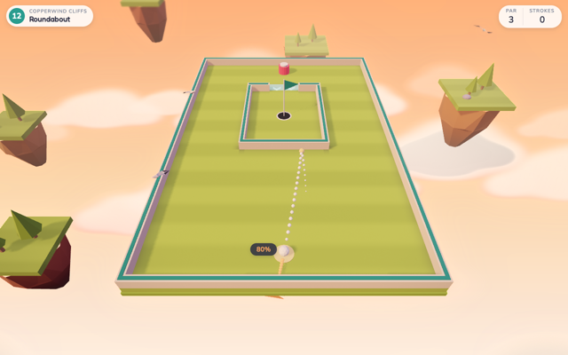
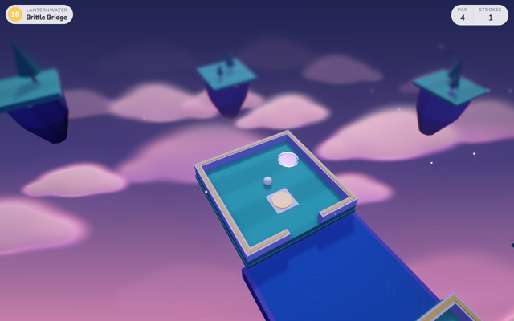
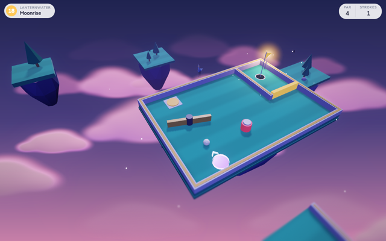

<p align="center"></p>

# Little Skies

Mini golf: thirty-six holes on four floating islands, each island
bringing in its own pieces, then twisting them together with the ones
before and ending on a hard hole, so that on the later holes the puzzle is
finding the route, not only aiming. Drag back from the
ball, let go to shoot.

A [helder](https://github.com/helder/helder) game, in Haxe: one program
for the web, Android, iOS and the desktop. Play it at
https://little-skies.helder.run.

| | |
|---|---|
|  |  |
|  |  |

The screenshots are the game's stories (`src/LittleSkies.story.hx`: a
hole's recorded round played to a moment, or an aim held), rendered by
helder; the same stories are helder.run's and the stores' screenshots
(below). `npx helder publish --run --dry-run` writes them to
`bin/shots/run`; these are those, scaled to 640 wide.

## Run it

Node 24 or later; helder comes from npm with its compiler, no Haxe
install needed.

```sh
npm install
npx helder dev                       # a window, live-reloaded
npx helder dev --target web          # the browser (WebGPU): http://127.0.0.1:4321/
npx helder run --target android      # a phone or an emulator (adb)
npx helder run --target ios-sim      # the iOS simulator (a Mac)
npx helder build --target web        # bin/web/little-skies.wasm and its page
```

## Test it

```sh
npx helder test --target all         # natively and as wasm32-wasi
```

- `src/Rounds.test.hx`: every hole's recorded round (`src/Rounds.hx`)
  replayed on the simulation alone: each holed in its strokes, at or under
  par; a step allocating only while the physics' buffers grow; before
  each shot the aim's preview, played to the end, leaving the ball where
  the shot does, bit for bit; 48 previews from each tee allocating
  nothing. The physics has no trigonometry or transcendental functions in
  a step, so the same shots give the same bits natively and as wasm.
- `src/LittleSkies.story.hx`: each story mounted and settled, its tree
  snapshotted (`src/LittleSkies.story.snap`).

`src/Shots.hx` holds the tools the rounds were found with:

```sh
npx helder run src/Shots.hx -- search 5                 # shots that hole hole 5 from the tee
npx helder run src/Shots.hx -- search 16 '[[-0.5249, -0.8512, 3.65]]'   # the next shot after these
npx helder run src/Shots.hx -- trace 16 '[[-0.5249, -0.8512, 3.65]]'    # the ball's way, every quarter second
npx helder run src/Shots.hx -- preview 1 0 -1 4         # the aim's preview of a shot
npx helder run src/Shots.hx -- tune                     # how far a shot rolls on a flat green, by speed
npx helder run src/Shots.hx -- finish 8 '[[-0.3663, -0.9305, 5.55]]'    # the steadiest putt holing it after these
npx helder run src/Shots.hx -- survey 8                 # aces from the tee, an aim-at-the-cup player, each recorded shot's slack
npx helder run src/Shots.hx -- noisy 8 24               # 24 rounds by a good player with a hand's errors: how often par
```

`noisy` is how the pars were set: a player who knows the hole (it plays
the recorded round's shots, or heads for where they would have left the
ball, and takes the steadiest putt whenever one can hole it) but whose
hand is off by about 1.5 degrees of aim, 4% of power and 0.07 s of timing.
Par is what that player makes most of the time: nearly always on an
island's first holes, about half the time on its last. Real players plan
less well, so for them the holes are harder than the numbers below.

## The islands

Each island's holes run from easy to hard, the last of them hard. Par is
set from the `noisy` player (above): the share of its rounds at par or
better is the last column.

| | Hole | Par | Par made | Brings in |
|---|---|---|---|---|
| **Meadowdrift** (spring day) | 1 First Putt | 2 | 100% | the shot: not too hard, the far end is open |
|  | 2 The Bend | 2 | 92% | banking off a rail |
|  | 3 Uphill | 2 | 100% | a slope, the cup off the ramp's line |
|  | 4 Pinball | 2 | 92% | bumpers, kicking the ball away |
|  | 5 Sandy Shortcut | 2 | 88% | sand: the straight line, or round by the fast lane |
|  | 6 Terraces | 3 | 92% | two ramps across from each other: stop on each terrace |
|  | 7 The Leap | 2 | 71% | a kicker over a gap |
|  | 8 Carom | 3 | 75% | the cup in a pocket facing the block in front of it: bank round the block into the sand behind it |
|  | 9 Hilltop Hop | 3 | 58% | risk or reward: a narrow bridge with no rails and sand, or the jump over the gap past the bumpers |
| **Copperwind Cliffs** (sunset) | 10 Booster Run | 2 | 96% | boosters up a slope; the top has no back rail, a slider on it |
|  | 11 Lift Off | 2 | 92% | a lift: stop on it, ride up, shoot off |
|  | 12 Sliders | 2 | 75% | blocks sliding across the lane: timing |
|  | 13 Turnstile | 2 | 79% | turnstiles, turning opposite ways |
|  | 14 Roundabout | 3 | 88% | a one-way gate: the cup's pen opens only from the far side |
|  | 15 Crosswind | 2 | 58% | wind on a bridge without rails (in the air too) |
|  | 16 Gearbox | 3 | 71% | an L of turnstiles, a bumper in the corner to bank off |
|  | 17 Updraft | 2 | 75% | a booster and a kicker, wind over the gap one way and over the green the other |
|  | 18 Clockwork | 4 | 71% | lift, turnstile, wind and a one-way door into the cup's pen |
| **Lanternwater** (dusk) | 19 Skipping Stone | 2 | 83% | water (a stroke): over the pool, or down round it |
|  | 20 Wormhole | 2 | 75% | a portal to an island with no bridge |
|  | 21 Lantern Falls | 4 | 75% | a waterfall: down three switchback ramps, the ball gaining speed on each; too fast and it goes over into the pools |
|  | 22 Mirror Pools | 3 | 67% | two portals: the one in the way drops the ball in a pool, the other is banked into in its corner |
|  | 23 Flip Switch | 3 | 50% | a switch in a bay opening the gate across the lane |
|  | 24 Two Doors | 3 | 63% | one switch group: as one gate opens the other shuts |
|  | 25 Brittle Bridge | 4 | 63% | crumbling tiles to the switch; back by the portal through the gate it opened |
|  | 26 Lockstep | 3 | 54% | two gates, a plate right before each: the first opens the near one, the second shuts the far one |
|  | 27 Moonrise | 5 | 25% | portal, turnstile, switch and a gated pen together |
| **Frostglass Peaks** (winter) | 28 First Frost | 2 | 100% | ice: it hardly slows the ball |
|  | 29 Ice Rink | 2 | 96% | banks on ice keep their speed: round the block to the corner |
|  | 30 Curling | 2 | 83% | stones guarding the cup: banked round them on the ice |
|  | 31 Frozen Portal | 2 | 75% | a turnstile before the portal, ice beyond it |
|  | 32 Snowgate | 3 | 75% | a plate on ice: the ball can roll over it twice and flip it back |
|  | 33 Icefall | 3 | ICEFALL | a frozen waterfall: down three drops, each landing's rail with a gap, right then left |
|  | 34 Glacier Slide | 2 | 50% | sliders across ice: steady speed, true timing |
|  | 35 Thin Ice | 3 | 46% | cracked strips over a pool, each falling once crossed, to an ice island |
|  | 36 Aurora Summit | 4 | 33% | boosters, ice, a turnstile, a plate in a bay and a gated pen |

Stars: three for par or better, two for one over, one for finishing.

## Controls

- **Shoot**: put a finger (or the mouse) on the ball, drag back, let go.
  The dots show where it goes: the ball's own path, played ahead by the
  simulation, clear up to the first bounce (a gold dot) and fading soon
  after, ending in a red dot at a bumper, gate, turnstile or sliding block
  in the way. The farther you pull, the harder.
- **Look around**: drag anywhere else to turn the camera round the ball;
  pinch to zoom, twist with two fingers to turn (the mouse: drag, the
  wheel). As a hole starts the camera flies from the cup back to the tee
  under the hole's card (a press skips it).
- **Holes**: the hole's pill (top left) opens the scorecard: a page an
  island (swipe, or its tab), its holes in a grid with their stars and
  bests; a hole opens once the one before it is finished. Falling off,
  or into the water, puts the ball back where you hit it from, a stroke
  more. Best scores are saved on the device.

## How it is built

`helder.json` is the app (its name, id `build.helder.littleskies`, icons,
helder.run's block, the stores), its entry `src/LittleSkies.hx`.

- `Course.hx`: the islands (their sky, colours, sun, fog, grade) and the
  holes as data, each a list of pieces (`Flat`, `RampZ`/`RampX`, `Wall`,
  `Block`, `Post`, `Bumper`, `Mover`, `Spinner`, `Lift`, `Boost`, `Wind`,
  `Sand`, `Ice`, `Water`, `Portal`, `Switch`, `Gate`, `OneWay`,
  `Crumble`) with a tee, a cup, a par and a tip. A new hole is an entry
  there and nothing else.
- `Sim.hx`: one hole on helder.physics at 120 steps a second: the ball a
  sphere sliding with a little friction and a drag in proportion to its
  speed; rails, posts and bumpers bounce it; movers, lifts, turnstiles and
  gates are static bodies placed each step with their velocities set. The
  pieces' own rules run after the physics' step. No sin, cos or exp in a
  step (`Sim.yaw` turns a turnstile by series and doublings), so the same
  shots give the same bits everywhere.
- `Aim.hx`: the aim's preview, a ghost of the hole's simulation set to the
  live one's state (`Sim.mirror`) and played on with the shot being aimed.
- `Rounds.hx`: the recorded rounds; `Shots.hx`: the tools that found them.
- `Game.hx`: the scene's nodes made from the pieces (`Kit.hx`'s unit
  meshes, flat shaded, drawn instanced), each island's light and colours,
  the camera (`<OrbitControls>` driven by the game: the fly-over,
  following, facing the cup), and the juice: particles (`Particles.hx`),
  ripples, lanterns, a squash on each hit, a shake on hard ones, slow
  motion on a hole-in. A frame of play allocates nothing.
- The diorama look: each hole a model on a table of cloud seen through a
  tilted lens: `TiltShift.hx` (a tilt-shift depth of field, a stage of the
  post chain), `Clouds.hx` (the cloud sea, its own shader in one draw),
  `Dressing.hx` (contact shadows, the lanterns' halos), `Creatures.hx`
  (birds, swallows, bats, moths and a heron, on the view's clock and their
  own random stream: they never touch the simulation), `Turf.hx` (the
  greens mown in stripes, a material's colour slot). A quality switch
  drops the blur and thins the cloud sea after two seconds of slow frames.
- `LittleSkies.hx`: the window, the `<Scene hdr>` and the HUD in helder.ui's
  markup (the title, the hole's card, the score, the card after a hole-in,
  the scorecard, a curtain between holes), clear of a phone's bars, for a
  phone upright and a window on its side. The title is the brand's lockup
  in the island's colours over a haze of its sky (`brand/`).
- `Sounds.hx`: a tock, knocks, a thud, a boing, a warp, a click and a
  rumble, a crumble, a splash, a whoosh, the cup's plunk and a chime, all
  made procedurally. `Save.hx`: the best scores, kept by helder.os's
  `Store`.
- `brand/`: the lockup (`title*.svg`: per island, light, small) and the
  hazes, the icons (dusk, the default: `icon-ios.svg`, Android's adaptive
  layers `icon-android-foreground.svg`, `-background.svg` and
  `icon-monochrome.svg`; the day ones kept as `*-day.svg`).

## Publishing

`.github/workflows/`:

- **run.yml**: every push and pull request runs the tests; a push to
  main then publishes the web build to helder.run (`npx helder publish
  --run`: https://little-skies.helder.run, its page
  https://helder.build/little-skies). No secret: GitHub Actions' OIDC
  token (`permissions: id-token: write`). The first publish from GitHub
  makes the address the repository owner's and trusts this repository.
- **release.yml**: a version tag (`git tag v1.0.0 && git push --tags`)
  runs the tests, then builds, signs and uploads the release to Google
  Play's internal track (`--play`) and to TestFlight (`--testflight`).
  The tag is the version; the workflow's run number is the build number
  (`.github/scripts/version.mjs`). Run by hand (Actions > release > Run
  workflow) it does the same with `--dry-run`: built, signed, the stores'
  APIs reached, nothing uploaded: try the secrets there first.
- **listing.yml**, by hand: the store screenshots, rendered from the
  stories at each store's sizes with their captions (`helder publish
  --screenshots`), set on the stores' listings (`--listing`, changed ones
  only; a dry run by default, the screenshots and their review sheet kept
  as an artifact).

The secrets (Settings > Secrets and variables > Actions), named as helder
reads them:

| Secret | What |
|---|---|
| `HELDER_ANDROID_UPLOAD_IDENTITY` | Play's upload key: its certificate and private key in one PEM (from a keystore: `keytool -importkeystore -srckeystore upload.jks -destkeystore upload.p12 -deststoretype PKCS12`, then `openssl pkcs12 -in upload.p12 -nodes`) |
| `HELDER_IOS_IDENTITY` | the Apple Distribution certificate and its private key in one PEM (`openssl pkcs12 -in distribution.p12 -nodes`; helder adds Apple's WWDR intermediate) |
| `HELDER_ASC_API_KEY` | an App Store Connect API key (App Manager): JSON of `key_id`, `issuer_id` and `private_key`, the `.p8`'s text (on one line is fine); or the three secrets `HELDER_ASC_KEY_ID`, `HELDER_ASC_ISSUER_ID`, `HELDER_ASC_KEY` |
| `HELDER_IOS_PROFILE` | optional: the App Store provisioning profile, base64; without it helder fetches the bundle id's with the API key |

Google Play, one of:

- **Workload Identity Federation** (preferred: no key to leak or rotate).
  In Google Cloud make a workload identity pool with a GitHub provider
  (issuer `https://token.actions.githubusercontent.com`, condition
  `assertion.repository == 'helder/little-skies'`), a service account,
  and let the provider's principal impersonate it (Workload Identity
  User). In Play Console invite the service account's email (Users and
  permissions) with the app's release permissions. Then set the
  repository variables `GCP_WORKLOAD_IDENTITY_PROVIDER`
  (`projects/<number>/locations/global/workloadIdentityPools/<pool>/providers/<provider>`)
  and `GCP_SERVICE_ACCOUNT` (its email): the workflows get a short-lived
  token from `google-github-actions/auth` (`token_format: access_token`),
  which helder reads as `GOOGLE_OAUTH_ACCESS_TOKEN`.
- **A JSON key**: the service account's key as the secret
  `HELDER_PLAY_SERVICE_ACCOUNT` (with the same Play Console permissions).

Once, before the first release: Play creates an app only from a first
bundle uploaded by hand (Play Console > Create app, then Testing >
Internal testing > Create release with `npx helder build --target android
--release --bundle`'s `bin/android/little-skies.aab`); App Store Connect
needs the app made (bundle id `build.helder.littleskies`) before
TestFlight takes a build.

Locally the same commands work with the same variables in the
environment (each a file's path or its text); never commit them
(`.gitignore` keeps `*.pem`, `*.key`, `*.p8`, `*.p12` out).

## Credits and licences

Made with [helder](https://github.com/helder/helder). The code is MIT
(`LICENSE`). The brand (`brand/`: the name's lockup, the icons) is Little
Skies' own.

Fonts, embedded in the game (`fonts/`, each with its licence):

- [Fredoka](https://github.com/hafontia/Fredoka-One) (the title, the holes'
  names), © 2016 The Fredoka Project Authors, SIL Open Font License 1.1
  (`fonts/Fredoka-OFL.txt`).
- [Nunito](https://github.com/googlefonts/nunito) (everything else), © 2014
  The Nunito Project Authors, SIL Open Font License 1.1
  (`fonts/Nunito-OFL.txt`); its variable font cut to Latin, its legacy
  family name set to "Nunito".
